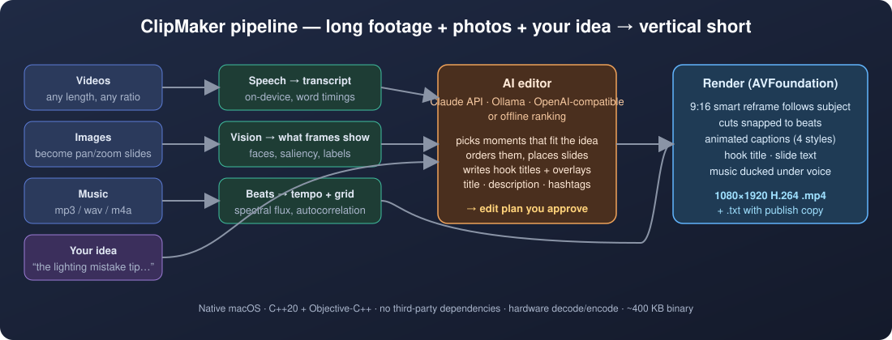
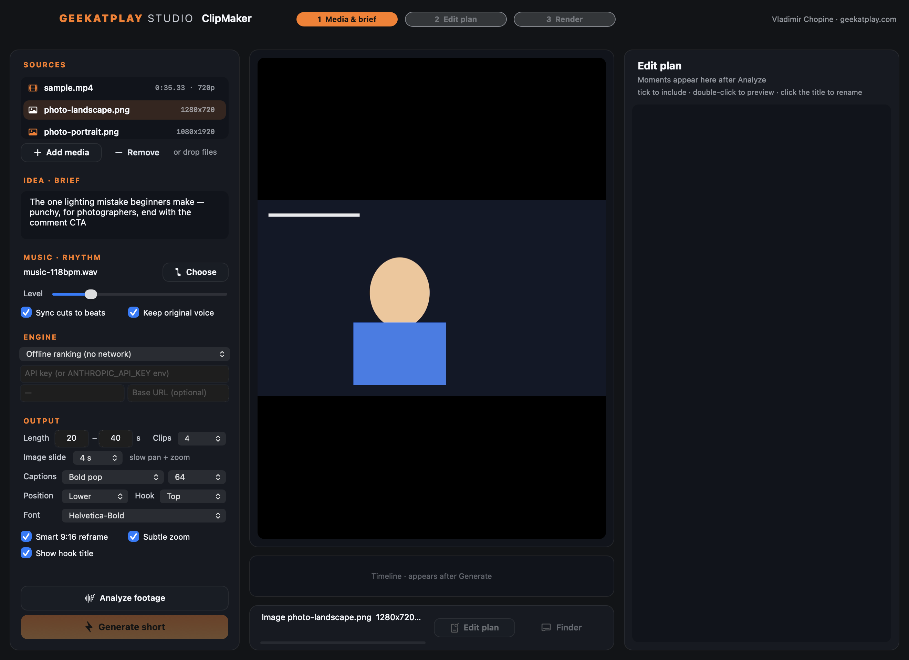
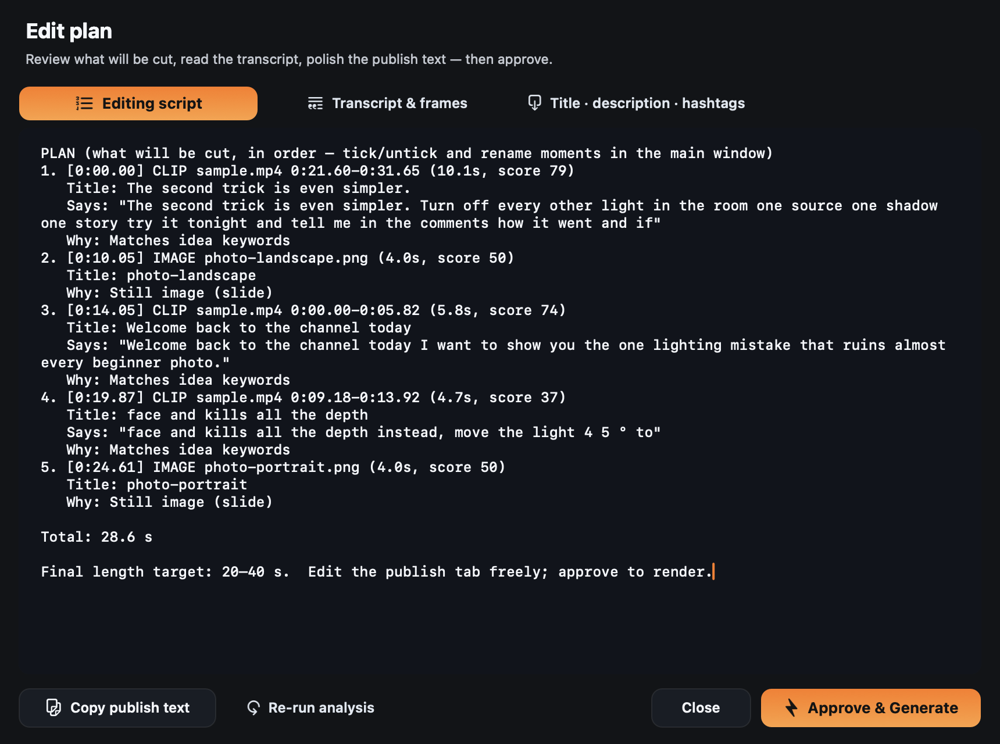
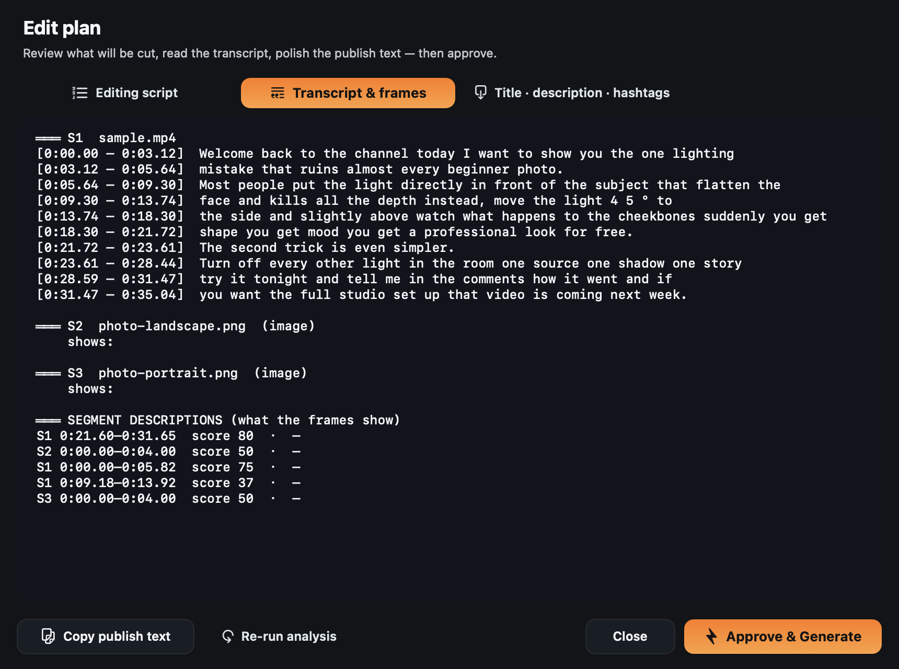
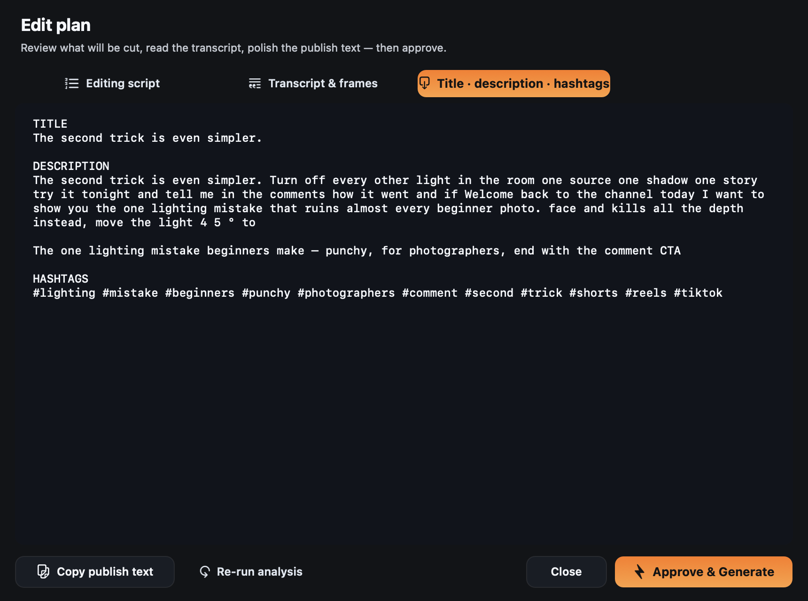
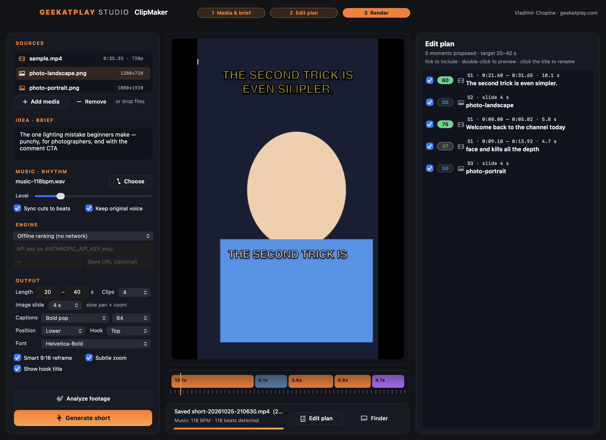

# ClipMaker — User Manual

*Geekatplay Studio · Vladimir Chopine*

ClipMaker turns long videos (plus optional photos and a music track) into a
vertical short. You describe the short you want; the app transcribes the
footage, asks a language model (or an offline ranker) for the best moments,
shows you the edit plan for approval, and renders a 1080×1920 MP4 with beat-synced cuts,
subject-tracking reframe, animated captions and publishing copy.



---

## 1. Requirements

| | |
|---|---|
| macOS | 13 Ventura or newer (Apple Silicon or Intel) |
| Permissions | Speech Recognition (asked on first Analyze) |
| Engine (optional) | Claude API key, a running [Ollama](https://ollama.com) server, or any OpenAI-compatible endpoint |
| Build tools (only to build from source) | Xcode Command Line Tools, CMake ≥ 3.20 |

No ffmpeg, no Python, no Electron. Everything runs on Apple's own frameworks.

## 2. Build & launch

```bash
git clone https://github.com/GeekatplayStudio/clipmaker.git
cd clipmaker
cmake -S . -B build -DCMAKE_BUILD_TYPE=Release && cmake --build build -j
open build/ClipMaker.app
```

The app is ad-hoc signed. macOS will ask for Speech Recognition access the
first time you Analyze, and again after each rebuild (a new ad-hoc signature
counts as a new app). Allow it; nothing leaves your Mac for transcription.

## 3. The window



| Area | What it does |
|---|---|
| **Sources** (top left) | Videos and images. Add with the button, ⌘O, or drag-and-drop. Click a row to preview it in the centre; images show as stills, videos play. Remove deletes the selected row. |
| **Idea / brief** | Tell the editor what the short is about, who it is for, the tone, and any must-haves ("end with the comment CTA"). The more specific, the better the picks. |
| **Music & rhythm** | Choose a music file. *Music level* is the volume under the voice (0–100 %). *Sync cuts to beats* nudges every cut onto the nearest beat and starts the short on a downbeat. *Keep original voice* off = music-only short. |
| **Engine** | Offline ranking (no network), Claude API (key), Ollama (local model name, default `llama3.1`), or an OpenAI-compatible server (base URL + key). |
| **Output** | Length window (min–max seconds), max number of video clips, slide duration for images, caption style/size/font, caption and hook positions, smart reframe, subtle zoom, hook title. |
| **Analyze footage** (⌘A) | Transcribe → describe frames → detect beats → build the plan → open the Edit plan. |
| **Generate short** (⏎) | Render the approved plan to `~/Movies/ClipMaker/`. |
| **Preview** (centre) | Source preview, candidate preview, and the finished short. Below it the timeline strip shows the clips (coloured by source) and beat ticks. |
| **Edit plan** (right) | Ranked moments. Tick to include, double-click to preview, click the title to rename the on-screen hook. Hover for the reason and what the frames show. |

## 4. Workflow

### Step 1 — Add media and check it
Drop one or more videos. Add photos if you want slides; each one plays as a
slow pan-and-zoom for the chosen *Image slide* length. Click any row to make
sure it is the right file and that videos have an audio track (the status bar
warns if not).

### Step 2 — Describe the short
Write the brief. Examples that work well:

- *"The one lighting mistake beginners make — punchy, for photographers, end with the comment CTA"*
- *"Best 3 moments about pricing objections, calm and credible, LinkedIn audience"*
- *"Funniest reactions, fast cuts, no narration needed"*

### Step 3 — Choose the engine
- **Claude API** — paste an API key (or export `ANTHROPIC_API_KEY` before launching). Default model `claude-sonnet-5-5`; type another model id if you prefer.
- **Ollama (local)** — run `ollama serve`, pull a model (`ollama pull llama3.1`), enter the model name. Nothing leaves the machine.
- **OpenAI-compatible** — base URL such as `https://api.openai.com/v1` or a local server, plus key and model.
- **Offline heuristic** — keyword relevance against your idea plus "hook" words and speaking pace. Works without network; titles and descriptions are rougher.

If a remote call fails, the app falls back to the offline ranking and tells you in the status bar.

### Step 4 — Analyze
Progress shows transcription (on-device, cached per file so a second run is
instant), frame description, music analysis, the plan request, and subject
tracking for the reframe. When it finishes the **Edit plan** sheet opens.

### Step 5 — Review the Edit plan



**Editing script** — the engine's rationale followed by the cut list in play order:
timecode, source, length, score, hook title, on-screen text, what is said,
what the frames show, and why it was chosen. Change the plan by ticking,
unticking or renaming moments in the main window; re-open the sheet with
*Script & transcript…* to see the updated list.



**Transcript & frames** — the full timestamped transcript of every source,
what each image shows, and a one-line visual description for every candidate
segment.



**Title · description · hashtags** — ready to paste into YouTube, TikTok or
Instagram. Edit freely; *Copy publish text* puts it on the clipboard, and it is
saved as a `.txt` next to the rendered video.

Buttons: **Approve & Generate** renders now; **Close** keeps the plan so you can
tweak and press Generate later; **Re-run analysis** builds a new plan (useful
after changing the brief or the length window).

### Step 6 — Generate



Rendering uses the hardware encoder; a 30 s short takes well under a minute on
Apple Silicon. The finished short plays in the preview, the timeline shows the
final clips and beats, and *Show in Finder* reveals the MP4 and its `.txt`.

## 5. Settings reference

| Setting | Effect |
|---|---|
| Length min – max | The planner fills to at least *min* (extending the last moment to a sentence end) and never exceeds *max* (trimming to a word boundary). |
| Clips | Maximum number of video moments. Images do not count. |
| Image slide | Seconds each photo stays on screen. Pan direction and zoom in/out alternate per slide. |
| Captions | *Bold pop* (outlined, pops in per phrase), *Karaoke highlight* (word-by-word yellow highlight), *Minimal pill* (text on a translucent pill, fades), *Outline* (thick stroke, no shadow), *None*. |
| Font / size | Any installed PostScript font name; sizes 48–84 px at 1080 px width. |
| Position / Hook | Five vertical positions each for captions and for the hook title. |
| Smart 9:16 reframe | Follows faces (or the most salient object) with a smooth pan; off = centre crop. |
| Subtle zoom | Slow push-in / pull-out alternating per clip. |
| Show hook title | Big title during the first three seconds of the first clip. |
| Music level | Music gain under the voice (automatic fade-out at the end). |

## 6. Command line

The same engine runs headless. Launch through `open` so macOS attributes the
Speech permission to ClipMaker rather than your terminal:

```bash
open -W --stdout out.log --stderr out.log build/ClipMaker.app --args --cli \
  --video talk.mp4 --image cover.jpg --idea "best moments about pricing" \
  --music beat.mp3 --provider anthropic --min 25 --max 40 --clips 3 \
  --style karaoke --out short.mp4
```

| Option | Meaning |
|---|---|
| `--video f` / `--image f` | Sources (repeatable, order = source index) |
| `--idea "…"` | The brief |
| `--music f` | Music track |
| `--provider heuristic\|anthropic\|ollama\|openai` | Engine (`--model`, `--key` optional) |
| `--min s` / `--max s` | Length window (`--length s` sets max and 60 % min) |
| `--clips n` | Max video clips |
| `--style bold\|karaoke\|minimal\|outline\|none` | Captions |
| `--out f` | Output path (default `~/Movies/ClipMaker/short-cli.mp4`) |

Debug helpers: `--make-sample out.mp4 "narration"` synthesises a narrated test
video with the system voice; `--frames video.mp4 dir` dumps eight PNG frames;
`--describe file…` prints the Vision labels; `CLIPMAKER_DEBUG=1` logs
subject-tracking keyframes.

## 7. Tips

- **Hooks sell the short.** The proposed hook title is editable in the right-hand list — three to six words, uppercase, works best.
- **Shorter window, better retention.** 20–35 s with 2–4 moments usually beats one long cut.
- **Music at 15–25 %** keeps the voice intelligible; go to 90 %+ only with *Keep original voice* off.
- **Photos as B-roll.** Drop a product shot or a before/after; the planner places it where the narration refers to it and writes a short overlay.
- **Re-run is cheap.** Transcripts are cached, so changing the brief and re-running analysis takes seconds (plus the model call).

## 8. Troubleshooting

| Symptom | Fix |
|---|---|
| "Speech Recognition permission prompt not answered" | Click *Allow* in the macOS prompt, or enable ClipMaker in System Settings → Privacy & Security → Speech Recognition, then Analyze again. |
| "No speech found" | The video has no audio track or no intelligible speech. Check it in the source preview. |
| Engine falls back to offline ranking | Check the key, the model name, that `ollama serve` is running, or the base URL. The status bar shows the HTTP error. |
| Captions missing | Caption style set to *None*, or the moment has no words (slides show overlay text instead). |
| Build fails linking (`tapi error`) | Your Command Line Tools linker is older than the newest SDK; the CMake file auto-selects an older SDK. Pass `-DCMAKE_OSX_SYSROOT=` to override. |

## 9. Privacy

Transcription, frame description, beat detection and rendering all run on the
Mac. Only when you pick a cloud engine does the transcript, the brief and
the image labels leave the machine, to that provider. The API key is stored in
the app's preferences; use the environment variable if you prefer not to store it.

---

© 2026 Geekatplay Studio · Vladimir Chopine · [geekatplay.com](https://www.geekatplay.com)
